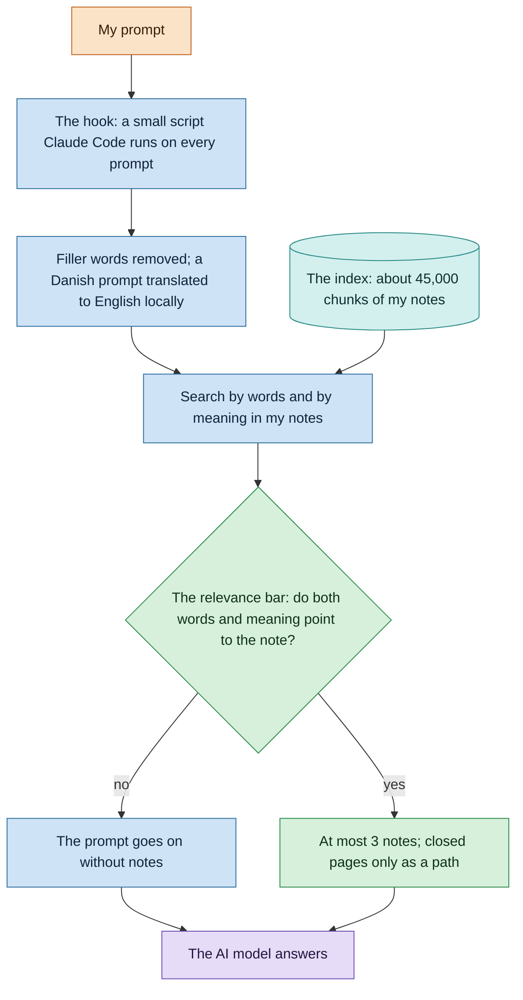
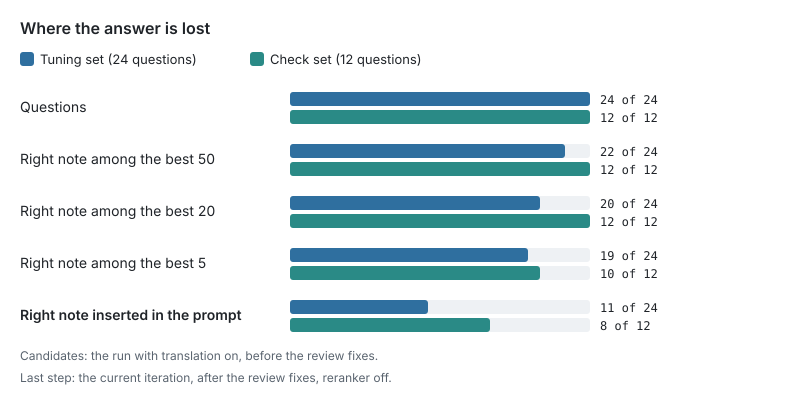

# recall: RAG over my own notes, on my own laptop

On every prompt I send an AI coding session, recall searches my notes and inserts the
relevant ones before the model reads the prompt. In its current iteration it inserts
the right note for 11 of 24 test questions, and inserts nothing on all 30 ordinary test
prompts and on 7 of the 8 in a smaller check set. Among its 20 best search results the
right note is there for 20 of 24. What I learned was to measure each stage on its own: the search was working, and
the loss was in the step that decides whether to insert anything.

I work with AI coding sessions (Claude Code) every day. My notes live in a notes vault
and in project folders, and the sessions did not use them, because nothing in a session
searched the notes.

This is not my first go at it. In the summer I ran a quick trial of searching a small
set of notes from one project by meaning: the search itself worked, and a small
English-only embedding model could not connect my Danish questions to English notes.
Later that summer a full plan followed for a memory system shared across my projects,
with Postgres and pgvector as its search index; it was reviewed and approved, and never
built. Neither attempt gave me a working system, and this autumn my sessions kept
missing what my notes already said: I know of five cases in a little over two weeks, and
in one of them a session planned the memory work from scratch while the approved plan
sat in a folder. The first version this autumn was built in one day, and in it the
choice of when to search was left to the AI (the first story below). The current
iteration, the one described here, is the one I directed part by part.

**I directed the work; an AI coding assistant wrote the code.** So this page is about my
choices and the places where I overruled the AI. The numbers here are from the current
iteration. I have paused the work after this iteration for now, and [the section near
the end](#where-it-stands-and-the-next-iteration) says why and what the next iteration
would try. The code lives in a private repository; this repo holds the overview, the numbers
and their sources.

> More technical detail: [Technical overview](tech.md). What was tried and dropped: [Experiments](experiments.md).

## Who does what

| What | Who |
|---|---|
| The goal, what RAG should mean here, and what "done" means | Me |
| What leaves my machine, which notes may be quoted, the hardware limits | Me |
| The rule for technical choices: published practice, plus a measurement on my own setup | Me |
| What is kept, based on the measured result | Me |
| Reading the result of each part (the measured numbers and what was missed) before starting the next; the test for each part is agreed before the code | Me |
| The code, the measurements and a report for each part | An AI coding assistant (Claude Code), in sessions I directed |
| Review of each part | A separate AI session that reads the code |

My everyday way of working here is to direct one AI that builds and a second AI that
reviews. The tuning set and check set described below are how I would test any agent
before it is rolled out: a known set of cases, a separate set it was not adjusted on,
and a count of the times it acted when it should have stayed silent.

## How the current iteration works

Orange: me. Blue: ordinary code and the small models running locally. Purple: the AI I
work with. Green: control. Teal: data.

## My main choices, and why

| Choice | Why |
|---|---|
| The search runs entirely locally | Not everything should leave my machine |
| A privacy stamp per page and per folder that marks it open or closed; a closed page is passed on only as its path | Otherwise the search becomes a back door around the stamps I had already set. Material fetched from the web is open, because it was public to begin with |
| Postgres with pgvector | It is the database I use most, and words and meaning can sit in the same row |
| A multilingual embedding model | My questions are often in Danish, my notes in English. Chosen on the Scandinavian Embedding Benchmark and tried locally before it was used |
| Search by both words and meaning | Names and technical terms are found best by their words, paraphrases by their meaning |
| Stay silent when unsure | A wrong note in the prompt leads the model astray. The first version said "found" on 19 of 22 ordinary prompts |
| A 20 s time budget, and the hook never blocks a prompt | A right answer matters more than a fast one. After one timeout recall is skipped for 60 s, so a hung service does not hit every prompt |
| The graphics card must stay under 80 °C | A limit I set to spare the card; it was exceeded once, for about ten minutes during a test, and measurement scripts now stop themselves at 79 °C |

The search, the index and the models that search run on my own machine. What recall
inserts becomes part of the prompt, and the prompt goes to the cloud model my AI coding
assistant uses, run by a company outside the EU. That is why every page and folder
carries a privacy stamp, and why a closed page is passed on only as its path, without
its text, although a file name can itself say something about the page, which is a
known limit of the current iteration. For a municipality, which I have not built for, I would map the same stamps to
data classes (public, internal, personal or confidential): personal data stays on
machines the organisation controls, or goes only to a model it has approved.

## Four times I overruled the AI

**The sessions never called the search.** The first version had a search that a
session could call when it chose to. My sessions did not call it, so what my notes said
never reached the prompt. The AI still reported the job done and answered "yes" when I
asked whether we had RAG now. What I wanted was the kind of RAG where the system adds
the knowledge to the prompt by itself, and I said so. The work restarted as the current
iteration, built around a hook in three parts, each with a test agreed before the code.

**Keep a steady pace.** To keep the graphics card cool during the first index build, the
AI proposed pausing and resuming the work. I said a steady, slower pace is better for
the hardware. The result is a control that slows the work as the card warms and keeps it
running. Unpaced, the card ran at 85-87 °C; paced, it peaked at 78 °C.

**The hook may wait longer.** The AI set a two-second limit for the hook. I raised it to
ten seconds after two answers, of 3.7 s and 2.5 s right after a reboot, were dropped.
Later a prompt was lost at about 11 s when the laptop was short of memory, and I raised
the limit to twenty. Prompts that had been getting nothing then got their notes.

**About half right was not good enough.** When recall inserted the right note for about half
the test questions, the AI explained why that was acceptable. I said others report far
better, so something must be wrong, and asked for each stage to be measured on its own.
That measurement is the funnel:

The figure combines two runs: the candidate counts are from the translation run before
the review fixes, and the last step is the current iteration after them.

For what the published work says, I rely on two research reports, each written by a
different AI research tool. Nobody has checked their sources. According to them,
published work usually counts whether the right text is among the 20 best results.
Counted that way, recall finds the right note for 20 of 24 questions and 12 of 12 in
the check set, which is in the range those reports describe. The answers are lost at a
step the systems in those reports do not have: deciding whether to insert anything at
all. Recall needs that step because it sits in front of everything I type, and most of
what I type is not a question about my notes.

## How a change is judged

Every change is measured on two question sets. What is measured is whether the right
note is found and inserted into the prompt; whether the answer the AI then gives is
better has not been measured. The tuning set (24 questions and 30
ordinary prompts) is the one the thresholds were tuned on. The check set (12 questions
and 8 ordinary prompts) was written before any of the tuning it checks, and no
threshold is set on it. It is used as a guard when deciding what to keep: a change
stays only if it raises the tuning set without lowering the check set. It is small,
so a gain of one question on it proves little.

Translating Danish prompts raised the tuning set from 10 to 12 of 24 and the check set
from 5 to 8 of 12, with 1 of 30 false insertions, and stayed. A review then found two
flaws in the rule that decides whether to insert: a Danish prompt passed more easily
than the same prompt in English, because a Danish word and its translation were counted
as two signs of relevance, and short English or code prompts were sometimes taken for
Danish. With both fixed the result was 11 of 24 and 0 of 30 false. The fix stayed, and
11 is the number reported: the keep rule is for changes meant to improve the search,
and a fix to a rule that was wrong is kept because the rule was wrong, whatever it does
to the score.

A reranker, an extra model that reads the prompt and each candidate together, reached
16 of 24, the number the last part had to reach (set in the design before any part was
built, as 16 of 21 on the smaller set used then). It met the keep rule and is switched
off for its memory cost: in the trial a third of the service was swapped out to disk,
and recall became slower for every prompt. Its gain was also on the tuning set only;
the check set stayed at 8 of 12.

## The numbers as they are

| Measured | First version | Current iteration |
|---|---|---|
| Who starts the search | The session, if it remembers | A hook, on every prompt |
| Right note among the best 5 search results | 8 of 21 | 19 of 24 |
| Right note inserted into the prompt by itself | Never; nothing inserted anything | 11 of 24, and 8 of 12 in the check set |
| Something offered where nothing belonged | "Found" on 19 of 22 ordinary prompts | Inserted on 0 of 30, and 1 of 8 in the check set |
| Time for one lookup | About 10 s, up to 244 s after a reboot | About 1 s (median, on a busy machine short of memory) |

24 and 12 are questions with a known right note; 30 and 8 are ordinary prompts where
the right answer is nothing. The first version was measured on an older set of 21
questions, which the current 24 include. The current iteration's "best 5" figure comes
from the same run as the funnel's candidate counts. The current lookup time is the
median of the final run of the current iteration (1.09 s on the tuning set, 1.00 s on
the check set), taken while the laptop was busy and short of memory; the 0.6 s in
[Experiments](experiments.md) is an earlier run right after a restart. The check set scores higher than the
tuning set (8 of 12 against 11 of 24); with 12 questions that difference is within
chance, and the two sets were written at different times. One question moves the tuning
set by four percentage points, so the numbers show a direction. Sources: [where the
numbers come from](stats/SOURCES.md).

## Where it stands, and the next iteration

### Where the current iteration stands

Recall runs on every prompt in all my sessions. An example from daily use: I asked a
session for a write-up "like the one we have for" another of my projects, naming it
only by its short project name. Recall inserted three of my notes that said what that
earlier write-up was, that it was already public and where it lived, so the session
knew what I meant without my explaining.

### Why it stops here for now

I have paused the work here because of time, other projects and hardware. I will start
the next round of improvements when I have time for it. The hardware sets the clearest
limit. The reranker reached the design's target of 16 of 24 (set as 16 of 21 on the
smaller question set of that time) and is switched off. The service held about 2.1 GB
of memory without it and 3.1 to 3.2 GB with it, so it needs about 1.1 GB more, and the
laptop often has less than that free while I work. Another try would want about 1.5 GB
more free memory than the laptop had during the trial. Recall also slows down when the laptop is busy, which is the normal state of a
work machine: the first time I sent the prompt in the example above, it got nothing,
because recall needed about 11 s and the hook gave up at 9.5 s.

So the next step is on the laptop itself. I am moving the laptop from Windows to Linux, and
I expect that to leave more memory and processor time for work like this. I have not
measured that yet. The move takes a while, and I will finish it before I start the
next iteration.

### What the next iteration would try

A larger test set comes first, because every other change is judged on it. After that
the order starts with the decision step: the search already finds the right note among
its 20 best results for 20 of 24 questions, and the answers are lost when deciding
whether to insert anything. The items marked "research" come from the two research
reports (unchecked). The reasoning and the numbers
behind each item are in [Experiments](experiments.md#next).

| Area | What I would try | Why |
|---|---|---|
| Measuring | A test set of 150 questions or more | With 24 questions, one question is four points |
| Deciding | Tell a real question about my own material from an ordinary prompt, and give a real question several of the best notes | The strict bar is there to keep wrong notes out of ordinary prompts; a real question can take more |
| Deciding | A one-line pointer to the note when recall is half sure | A third answer between inserting a note and staying silent |
| Deciding | A fourth and fifth note when several clear the bar | One right note was lost to the cut at three |
| Deciding | A small page of the facts I ask about most, loaded at the start of every session (research) | Those questions would need no decision at all |
| Search | Table rows indexed together with their column headers (research) | A row without its headers often loses its meaning |
| Search | A proper BM25 word search (research) | The pipelines in the reports use BM25 for the word leg, and recall's word search is not BM25 yet |
| Speed | Recall holding its speed on a busy machine: a higher priority, keeping it in memory, a more compact search model | A slow answer is dropped by the hook |
| Speed | The reranker again, once there is memory for it | It reached the target, and on this laptop it slowed every prompt |

## Beyond one person

None of this is built or tested; it is how I would approach it. Recall would run as a
shared service on a server. Access would follow each person's
existing permissions, so it never inserts a page the person could not open. A log would
record what was inserted for whom, without the prompt text. Before anything is switched
on for everyone, I would write a test set together with the people who will use it, and
keep a check set apart.
