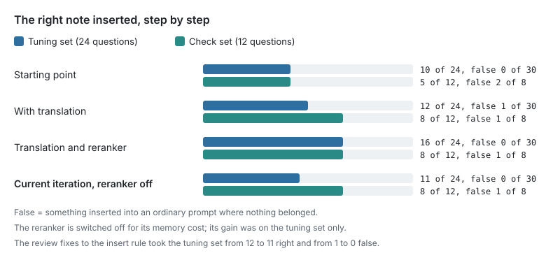

# Experiments

What was tried, what stayed and what was dropped, all measured in the third and last
part of the current iteration.
What runs is in the [Technical overview](tech.md). A change stays only if it raises the
tuning set without lowering the check set (a small validation set, described in the
[README](README.md#how-a-change-is-judged)), with at most 2 of 30 and 1 of 8 false
insertions.

## Translating Danish prompts: kept

My notes are in English and many of my prompts are in Danish. A Danish prompt is
translated on the CPU by a small dedicated model, and both the original and the
translation are searched.

| Measured | Without | With |
|---|---|---|
| Tuning set, right note | 10 of 24 | 12 of 24 |
| Check set, right note | 5 of 12 | 8 of 12 |
| False insertions | 0 of 30, 2 of 8 | 1 of 30, 1 of 8 |
| Cost | | About 0.3 s per Danish prompt, about 550 MB of memory |

A review then fixed two flaws in the rule that decides whether to insert (a Danish
word and its translation counted twice, and short English or code prompts taken for
Danish). The kept setup after the fix gives 11 of 24 and 0 of 30, which is the last
step in the figure; the [README](README.md#how-a-change-is-judged) has the details.

One question is still missed: "hvilket grafikkort har jeg" ("which graphics card do I
have"). The translation is right ("What graphics card do I have?"), but my notes say
"GPU", so translating the prompt does not help here.

## A reranker: reached the target, switched off

A reranker reads the prompt and each of the 20 candidates together and scores whether
the text answers it. It was used to order the candidates, to veto weak ones, and to let
short prompts in on a lower bar.

| Measured | Translation only | With reranker |
|---|---|---|
| Tuning set, right note | 12 of 24 | 16 of 24, the design's target (set as 16 of 21 on the smaller set of that time) |
| Check set, right note | 8 of 12 | 8 of 12 |
| Memory used by the service | 2.1 GB | 3.1-3.2 GB, about 1.1 GB more |
| One lookup, median, in the trial | 0.6 s | 1.4 s |
| With little free memory | | A third of the service swapped out to disk: median 1.6 s, one prompt 17 s |

The 0.6 s is from a run right after a restart. The README's lookup time of about 1 s is
the current iteration measured later, on a busier machine with less free memory.

On this laptop it made recall slower and less reliable for every session, so it is off,
and the code stays. Its gain of 4 was also on the tuning set only; the check set stayed
at 8 of 12. Worth another try when the laptop has about 1.5 GB more free memory than it
had during the trial: about 1.1 GB for the reranker itself, and room for the rest of the
service to stay out of swap.

Two other placements were measured and dropped. On the CPU: 6.2 s per prompt and 3.1 GB
more memory. Everything on the graphics card: 5.9 of its 6 GB in use and a median of
3.8 s. The trial above used the graphics card for the reranker only.

## A wide candidate list: dropped

Published pipelines let the reranker read 100-150 candidates, according to the two
research reports (unchecked). Measured here:

| Candidates | Reranking, median | Right, tuning set | False, check set |
|---|---|---|---|
| 20 | 0.76 s | 16 of 24 | 1 of 8 |
| 150 | 5.7 s | 17 of 24 | 3 of 8 |

A wider list cost up to 5 s more per prompt and let more ordinary prompts in. During
this measurement the graphics card ran at 80-87 °C for about ten minutes, above my
80 °C limit, because the script checked the temperature only between runs.
Measurement scripts now stop themselves at 79 °C.

## Passing on more notes: dropped

In the current iteration recall passes on only the notes that clear the bar. It could
instead pass on the best 5 as soon as one clears it. That gained one check-set question
(9 of 12 instead of 8) for about 800 more characters per prompt. One question out of twelve is too little
evidence for that cost.

## Next

The README ends with the short list of what the next iteration would try. Here is the
reasoning behind it, with the numbers.

**Measuring first.** A test set of 150 questions or more, in Danish and English, with
questions my notes cannot answer among them. With 24 questions one question moves the
tuning set by four percentage points, and with 12 the check set by eight, so a gain of
one or two questions proves little. Every change below would be judged on that set.

**The decision step.** Among its 20 best results the search has the right note for 20
of 24 tuning questions and 12 of 12 check questions; 11 and 8 of them are inserted. The
first three changes aim at that gap with rules that cost no memory:

- Telling a real question about my own material from an ordinary prompt. A real
  question could then be given the best several notes without the strict bar, which
  is there to keep ordinary prompts free of wrong notes.
- A third outcome between inserting and staying silent: a one-line pointer to the note
  when recall is half sure, so the session knows where to look.
- A fourth and fifth note when several clear the bar, since the review fixes lost one
  right note to the cut at three. This differs from the trial dropped above, which
  passed on the best 5 as soon as one cleared the bar.

One more idea from the two research reports goes around the decision altogether: a small
page of the facts I ask about most, loaded at the start of every session. A question
it already answers needs no search and no decision.

**The search.** Two changes come from the two research reports: table rows indexed together with their column headers, since a row cut off
from its headers often loses its meaning; and a proper BM25 word search, which the
pipelines in those reports use for the word leg.

**Speed on a busy machine.** When the laptop is short of memory, part of the service is
swapped out to disk, and a slow answer is dropped by the hook. Three ways to hold the
speed: a higher priority for the service, keeping it in memory so it is never swapped
out, and a more compact search model, which would mean building the index again once.
The reranker comes back when there is memory for it, as described above, and a larger
check set would also show whether its gain holds outside the tuning set.
